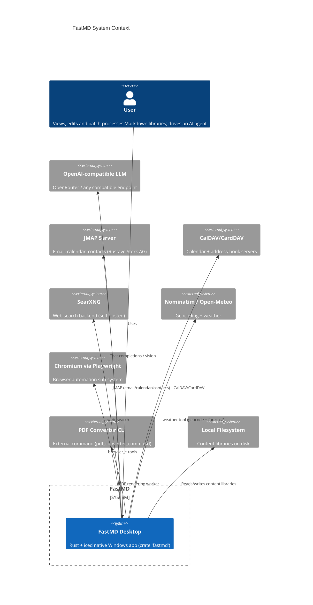
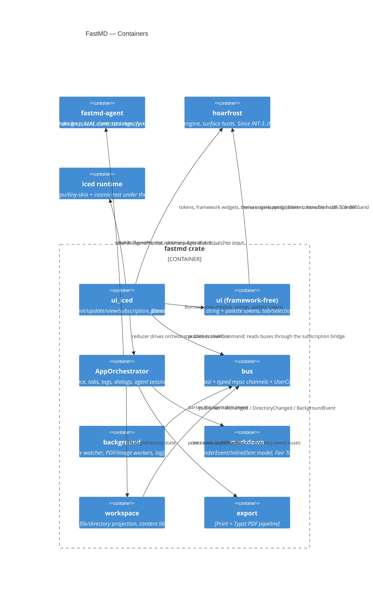
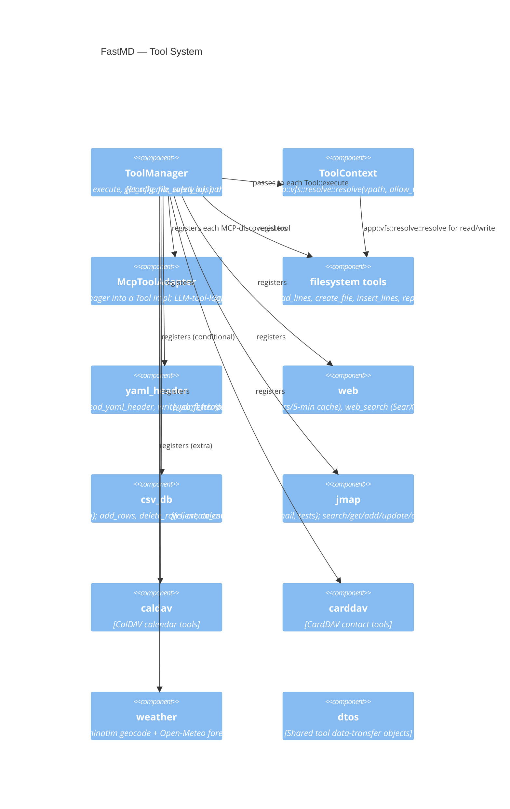
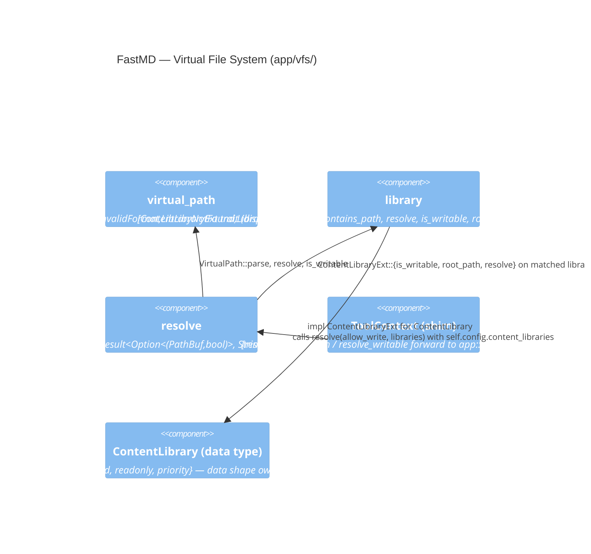
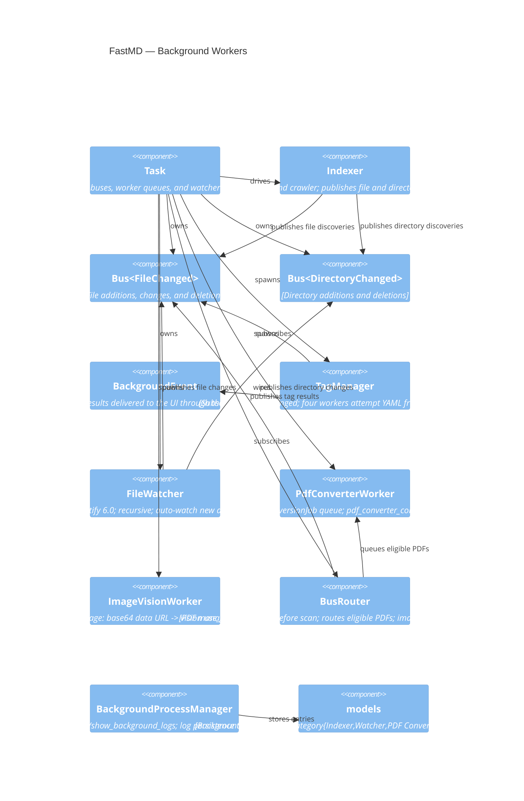
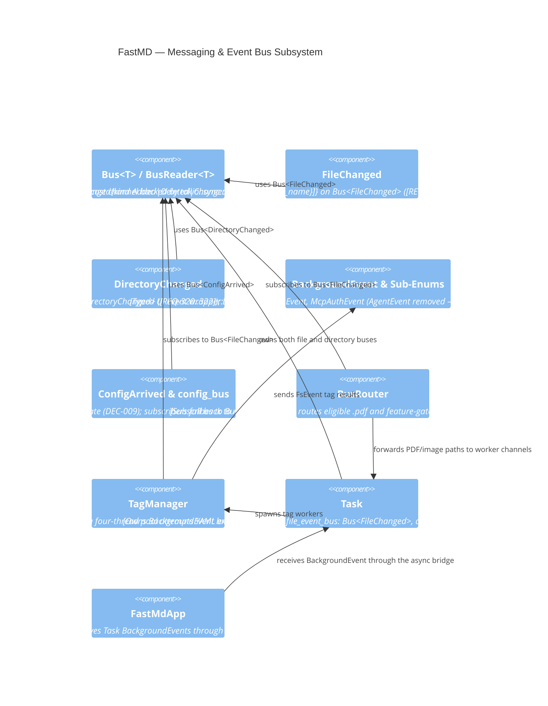
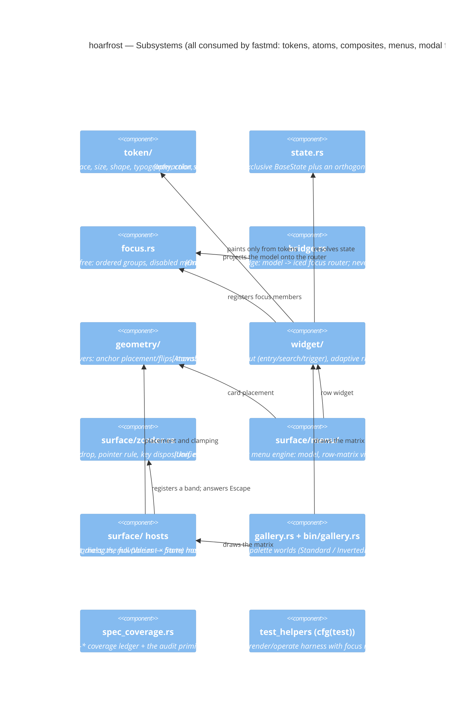

# FastMD C4 Architecture Diagram

## Context Diagram (Level 1)


## Container Diagram (Level 2)

The `fastmd` crate produces a single desktop application. The UI runs on the
**iced 0.14** runtime stack, all of it inside the one native binary:

| Layer | Crate (locked in `Cargo.lock`) | Role |
| --- | --- | --- |
| Windowing / OS event loop | `winit` 0.30 | Window creation, input events, DPI reports, close requests |
| GPU renderer | `wgpu` 27 | Hardware-accelerated paint (the `wgpu` cargo feature) |
| Software renderer | `tiny-skia` 0.11 | CPU paint path when no usable GPU backend is present |
| Text shaping | `cosmic-text` 0.15 | Font resolution, glyph shaping, text layout, hit-testing |
| Elm runtime + widgets | `iced` 0.14 / `iced_widget` 0.14.2 | `boot`/`update`/`view`/`subscription` loop, widget kit, theme/palette plumbing |

The application's own async work (buses, background workers, the agent driver)
runs on `tokio`; iced's futures executor is the default `thread-pool`, so the
two never share a runtime — they meet only at the `ui_iced::subscription`
bridge (see the Messaging diagram below).



There are three crates in this workspace that matter to the picture above:
`fastmd` (the application, `src/app/`), `fastmd-agent` (the agent engine,
`src/agent/`) and `hoarfrost` (`src/hoarfrost/`). The first two are wired
together — `AppOrchestrator` submits prompts to and observes events from
`fastmd-agent`.

`hoarfrost` is consumed by the application in two distinct ways, and the
distinction is the one thing a reader should carry away from this section.

**Tokens (since INT-1).**

- `src/app/ui/theme.rs` derives every overlapping semantic palette token
  from `hoarfrost::token::color::Palette::dark()` (`UIF-TOK-005`) instead
  of a literal, and delegates the inverted editor set to
  `hoarfrost::token::color::EditorPalette::inverted()` (decision **D-4**);
- `src/app/ui_iced/theme.rs` maps the framework palette onto the iced
  theme roles and takes the modal scrim from
  `hoarfrost::surface::zorder::scrim_for`;
- `src/app/ui_iced/layout.rs` binds the pane-grid resize leeway to
  `hoarfrost::token::size::SPLITTER_GRAB` (`UIF-TOK-002`).

**Widgets and surfaces (since INT-3, completed through INT-8).** The
framework's claim that the app renders "only as the design token source"
was true at INT-1 and is false now. The table below is the live
integration surface, read from the `hoarfrost::` imports of the production
modules under `src/app/ui_iced/` — not from an intention list.

| App module(s) | Framework subsystem rendered through |
| --- | --- |
| `hamburger.rs`, `context_menu.rs`, `menu_surface.rs` | `surface::menu` — `MenuCascade` openness controller, `model::{Menu, Row}`, `view` row matrix; `geometry::anchor` solves card placement and flips |
| `dialogs.rs` | `surface::input_dialog` — Create / Rename / Move / Delete; `widget::text_input` on the controlled path (`TextInputModel`, `TextInputEmission`), `validation::disallowed` + `validation::punish` |
| `about.rs`, `attributions.rs`, `batch_dialog.rs`, `editor.rs`, `tools_dialog.rs` | `surface::modal` — `ModalSizing` + `ModalFrame` for card geometry, `ResizeFloors` to bound a size the user dragged a card to, `ModalError` / `ErrorLocation` / `Recovery` for error placement and focus restoration |
| `movable_shell.rs`, `agent_debug.rs`, `logs.rs`, `persisted.rs` | `surface::movable` — `MovableHost` / `MovableSpec` drive the title bar, resize handles, follow-scroll geometry and `GeometryStorage` persistence |
| `panels/top.rs`, `panels/bottom.rs`, `panels/left.rs`, `agent/mod.rs`, `agent/prompt_input.rs`, `logs.rs`, `agent_debug.rs`, `batch_dialog.rs` | atoms — `widget::button_widget::Button` (+ `ButtonVariant`), `widget::text_input` (controlled `TextInputModel` / `TextInputEmission` on the bottom command field, agent prompt and left-panel search; callback `TextInput::new` on log/debug search and the Batch wildcard-pattern field, omitted in Directory mode per SPEC `BATCH-007`); Batch prompt candidates are discovered on the iced task executor when the dialog opens, and `StartBatch` carries the selected prompt body snapshot; prompt discovery errors use error code `BATCH-4001` |
| `tools_dialog.rs`, `batch_dialog.rs` | composites and status atoms — `composite::list_tile`, `composite::form_field`, `widget::badge`, `widget::toggle`, `widget::progress` |
| `attributions.rs` | `widget::hyperlink` |
| `panels/left.rs` | `composite::tree_row` — row geometry, selection band and the role-based label fill-lock **only** (see *Known integration gaps*) |
| `app.rs`, `update.rs`, `message.rs` | `surface::zorder` band model + `SurfaceRegistry`, `focus::FocusState`, `bridge::focus_task`, `geometry::clamp::ResizeHandle` |
| every converted surface | `token::{space, size, shape, typography, color, contrast}`, `state::{BaseState, VisualState}` |

The controlled text-input event boundary distinguishes an explicit
`Committed` (Enter or an explicit settle) from `FocusCommitted` (an edit
settled by blur), while both remain members of the commit tier. The mounted
agent prompt and bottom command field submit only the explicit event; blur
synchronizes their drafts without starting an agent run. Name dialogs
deliberately route both events to their existing submit behavior.

No `fastmd` type appears anywhere in `hoarfrost`'s API, so the dependency
stays strictly one-way.

**Still not consumed:** `ModalHost` and `InputDialogHost` (the app takes
their frame, sizing and error semantics but keeps dismiss ownership — see
*The ownership contract* under the `hoarfrost` component diagram);
`bridge::tab_task`, so framework-driven `Tab` traversal is not wired;
and the framework's `composite::search_input`, which does not exist. The
six FastMD document/log content tokens stay app-owned literals under
decision **D-2**. Porting what remains is the follow-on work decision
**D-8** describes. See the `hoarfrost` component diagram further down for
what that crate contains, what it deliberately does not own, and where
the seams between the two still leak.

## Optional Vector Search

When the `vector-search` feature is enabled, `app/background/vector_search.rs` owns a SahomeDB collection and `app/background/embeddings.rs` builds an OpenAI-compatible embedding client (via `async-openai`) from the user-configured `embeddings` model (AGENT-005). `Task` creates the shared service before starting the initial scan, subscribes it to `Bus<FileChanged>` before scan events are published, and injects the service into `AgentSession` through the existing `Extensions` container. Markdown chunks are hashed, embedded, and stored in the local collection; the read-only `vector_search` built-in tool performs searches through that service. The service does not replay file events emitted before its subscription and reports progress through `BackgroundEvent::Process(LogEntry(...))` every 100 processed Markdown files.


### UI Layer (Level 3)

`ui_iced/` renders the desktop app. The UI is one iced Elm loop — `boot`
(builds the state, returns the batched boot `Task` chain), `update` (the
reducer), `view` (pure widget construction) and `subscription` (the inbound
bus bridge) — wired together by `ui_iced::app::launch`. The loop's state is
`AppState` (`ui_iced/app.rs`), a **thin wrapper** around the framework-free
`FastMdApp` domain object plus the iced-specific runtime bits: the pane-grid
state, the live bus receivers, the injected UI-state storage, the OS scale
baseline and the last known viewport size.

The window is a **three-band** layout: the top toolbar band, the middle band,
and the bottom command band. The middle band is an
`iced::widget::pane_grid` split `left | (center | right)` — file tree,
document/agent surface, and the gated table-of-contents pane. Pane-grid resize
drags reduce 1:1 onto the pure `PanelLayout` widths, clamped by the UI-016
min/max constants. Every floating surface (context menu, inline editor, small
dialogs, log viewer, agent debug window, tools dialog, About, attributions,
batch dialog) is mounted by a single **overlay host** above the bands in a
fixed z-order, with a scrim layer that swallows input below the top card.

The view holds no state. Each panel is a pure function over a
view-model snapshot; all snapshots live in `AppState::models` and are rebuilt
by `AppState::rebuild_view_models` at the end of every `update` call, because
several iced widgets (notably `pick_list`) borrow their option vectors out of
the snapshot and cannot own them inside `view`. All colours flow from
`ui/theme.rs`, the single source of truth for the dark palette (`Palette`,
whose token type is `iced::Color`) and the inverted inline-editor token set
(`EditorColors`); `ui_iced/theme.rs` maps those semantic tokens onto the iced
palette roles and hands the resulting `iced::Theme::custom` to the launch
builder. Repeated iced idioms — the cursor-anchored, viewport-clamped context
menu, the blocking modal card, its corner resize grip and the full-area gesture
lane that carries a drag, the confirm/cancel button pair, the
follow-the-stream scroll rule — live in `ui_iced/overlay.rs` and
`ui_iced/logs.rs`, which the panels, modals, tree and renderers call instead
of hand-rolling the widget tree. Since INT-3..INT-8 the *geometry, frame
and band semantics* behind those idioms come from `hoarfrost` rather than
from local arithmetic, while open/close/dismiss ownership stays with
`OverlayState` — see *The integration contract* under the `hoarfrost`
component diagram.

```mermaid
C4Component
  title FastMD — UI Layer (ui_iced)

  Component(app, "app", "AppState (thin wrapper over FastMdApp) + ViewModels + OverlayState; boot/boot_with_persisted (build_state performs the synchronous DEC-009 ConfigArrived publish), window_settings, launch() builder chain")
  Component(update, "update", "Top-level reducer: window close/save, pane resize, Message::Command publish-and-execute, Inbound bus reductions, finish_frame tail + view-model rebuild")
  Component(view, "view", "Three-band layout with the real panels mounted, under the overlay host (z-ordered floating windows)")
  Component(sub, "subscription", "Inbound Subscription<Message> lanes: ConfigArrived, FileChanged, DirectoryChanged, AgentEvent, BackgroundEvent (pure bus_event_to_message mapper, Lagged(n) surfaced) + the winit window lane (close_requests, resize_events)")
  Component(msg, "message", "Top-level Message enum: one variant per logical interaction channel (Window, Layout, Command, Tree, Tab, Editor, Agent, Search, Logs, Theme, Render, Dialog, About, Batch, Tools, AgentDebug, Inbound, Boot)")
  Component(layout, "layout", "Three-band pane-grid geometry: Configuration tree, MiddleBandPanes id discovery, resize -> PanelLayout clamping")
  Component(panels, "panels", "Pure pane view functions: top toolbar, left tree/search, center tabs/document, bottom command band, right ToC rules")
  Component(render, "render", "Markdown viewing path: RenderEvent -> RenderBlock descriptors -> iced widgets (heading, inline, code, table, yaml)")
  Component(overlay, "overlay", "Context-menu + blocking-modal primitives: anchor clamping, scrim blocker, confirm/cancel pair; card sizing and frame now delegated to hoarfrost modal::ModalSizing / ModalFrame; modal resize grip + gesture lane shared with the movable shells")
  Component(menuui, "hamburger / context_menu / menu_surface", "Menu rendering through hoarfrost surface::menu (MenuCascade + row view) with geometry from geometry::anchor; solved card rects kept on state so the paint and the z-order registry agree")
  Component(movui, "movable_shell", "Movable card chrome driven by hoarfrost movable::MovableHost: title bar, resize handles, filter/footer bands, follow-scroll")
  Component(editor, "editor", "Inline Markdown editor modal: text_editor host, DEC-007 undo/redo history stack, pre-save GFM validation, front-matter-preserving save")
  Component(agentui, "agent", "Mounted agent panel: header/status, streaming transcript through iced's built-in markdown widget, thinking-delimiter gate, hoarfrost controlled prompt field, send/queue/cancel + chat-model pick_list")
  Component(windows, "logs / agent_debug / dialogs / about / attributions / batch_dialog / tools_dialog / search", "The floating-window view-models and pure rules behind each overlay card; logs and agent_debug ride MovableHost")
  Component(persist, "persisted", "PersistedUiState save/restore through the injected UI-state storage handler")
  Component(tablew, "table_width (iced adapter)", "Available width -> FTWA solver inputs -> pinned iced column widths; heuristic text measurer")
  Component(gate, "token_lint_gate", "App-side token gate: hoarfrost's own scanner run over ui_iced under an app Scope (colour owner ui/theme.rs, visual scope ui_iced/, app geometry registry + enumerated allow-list)")
  Component(theme, "theme", "Palette token -> iced palette-role mapping; Theme::custom('FastMD Dark'); scrim colour (UI-002/GUD-003)")
  Component(fonts, "fonts", "iced::font::load bootstrap for the embedded icon font + platform symbol fallback")
  Component(osshell, "os_shell", "Framework-free platform wrappers: open-in-system-editor, reveal-in-file-explorer, open-URL")
  Component(logo, "logo", "The single place the shared logo mark element is constructed")
  Component(pro, "hoarfrost (framework crate)", "Tokens, atoms, composites, menu engine, modal frames, movable hosts, z-order bands consumed by the modules above")
  Component(helpers, "test_helpers (cfg(test))", "Framework-free fixtures: test_app / test_app_state over in-memory storage")

  Rel(app, update, "boot -> update")
  Rel(app, view, "boot -> view")
  Rel(app, sub, ".subscription(receivers)")
  Rel(update, msg, "reduces every channel")
  Rel(update, sub, "Inbound messages originate here")
  Rel(view, panels, "mounts the bands")
  Rel(view, overlay, "stacks the floating layers")
  Rel(view, render, "renders the open document")
  Rel(panels, msg, "emits Message::Command / panel channels")
  Rel(panels, overlay, "context menus + modal cards")
  Rel(panels, layout, "pane geometry")
  Rel(render, tablew, "solved column widths")
  Rel(theme, app, ".theme(fastmd_dark_theme)")
  Rel(fonts, app, "font boot task in boot()")
  Rel(update, osshell, "platform side effects")
  Rel(panels, logo, "logo_mark")
  Rel(menuui, pro, "surface::menu cascade + geometry::anchor")
  Rel(overlay, pro, "modal::ModalSizing + ModalFrame")
  Rel(movui, pro, "movable::MovableHost rectangles")
  Rel(panels, pro, "button_widget / text_input / combo_box + tokens")
  Rel(app, pro, "SurfaceRegistry + FocusState (derived index only)")
  Rel(gate, pro, "token_lint scanner under an app Scope")
```



Supporting UI types (framework-free, in `ui/`): `TreeNode{name,path,is_dir,children:BTreeMap}`,
`ToCEntry{title,level,id}`, `PersistedUiState{schema_version,left/right_panel_width,window_x/y/width/height,font_size_scale,expanded_dirs}`.

## Component Diagram (Level 3) — Agent Core

`agent/` implements the LLM tool-loop. A single long-lived driver thread
(spawned by `AgentSessionManager`) owns a `Receiver<AgentPrompt>` and blocks
on `recv()`. On each prompt, it builds a per-session `AgentContext` and runs
`run_agent` directly inline (no double-spawn). The agent publishes
`AgentEvent`s on a `Bus<AgentEvent>` (tokio broadcast); the UI subscribes
and drains per frame.

> **Agent↔UI Seam (feature 003, complete)**: `agent/events.rs` defines the
> structured seam types — `AgentPrompt` (UI→agent mpsc input, carries
> `session_id: Uuid` + `cancel_flag: Arc<AtomicBool>`), `AgentEvent`
> (agent→UI `Bus<AgentEvent>` broadcast output, 11 session-tagged variants),
> `AgentStatus` (typed status), `ToolSideEffect` (file-creation side effect),
> `DelegateToolCall` (structured web-delegate trace). The old
> `BackgroundEvent::Agent(LegacyAgentEvent)` variant and the
> `tx_gui: Sender<BackgroundEvent>` path have been removed. UI formatting
> lives in `ui/render/agent_render.rs`; the agent has zero `ui::render` imports.

```mermaid
C4Component
  title FastMD — Agent Core

  Component(mgr, "AgentSessionManager", "AgentState{running,status,thinking,response,history,token_usage,total_usage,debug_entries}; owns prompt_tx (UI→agent mpsc) + event_bus (agent→UI Bus); driver_handle: JoinHandle; current_session_id: Uuid"")
  Component(impl, "run_agent / run_agent_inner", "Resolves LLM client, builds messages, get_tools_schema, ToolExecutor::new, turn loop; called inline by the driver (no double-spawn)")
  Component(ctx, "AgentContext", "config, prompt, history, active_file, active_dir, selected_files, cancel_flag, session_id: Uuid, agent_event_bus, file_event_bus; no tx_gui, no current_response, no session_number")
  Component(ev, "events", "AgentPrompt (UI→agent mpsc, carries cancel_flag), AgentEvent (agent→UI Bus, 11 session-tagged variants), AgentStatus, ToolSideEffect, DelegateToolCall — the agent↔UI seam types")
  Component(llm, "LLMClient", "parse_usage_block; OpenAI-compatible HTTP")
  Component(pb, "SystemPromptBuilder", "with_active_file/dir/selected_files; USER.md injection per library")
  Component(te, "ToolExecutor", "returns (results, Vec<ToolSideEffect>); safe tools parallel / unsafe tools sequential")

  Rel(mgr, impl, "submit_prompt -> run_agent")
  Rel(impl, ctx, "builds per-session context")
  Rel(impl, ev, "publishes AgentEvent on Bus<AgentEvent>")
  Rel(mgr, ev, "owns event_bus: Bus<AgentEvent>")
  Rel(impl, llm, "chat completions")
  Rel(impl, pb, "system prompt")
  Rel(impl, te, "dispatch tools")
```

## Component Diagram (Level 3) — Tool System

`tools/` defines the `Tool` trait and a `ToolManager` (formerly
`ToolRegistry`) that owns the catalog of built-in and MCP-discovered
tools, the per-group enable/parallel-safe/error state, and the
[`McpClients`](../../src/agent/lib/mcp/mod.rs). `ToolContext<'a>` is the single
parameter passed to every `Tool::execute`, carrying `&AppConfig` and
`&Bus<FileChanged>`.





Tool inventory (matches `Tools.md` + conditional tools):
- **Core Workspace (11):** `grep`, `read_tags`, `list_files_by_tag`,
  `list_files`, `read_file`, `read_lines`, `create_file`,
  `insert_lines`, `replace_text`, `read_yaml_header`,
  `write_yaml_header`.
- **Web Integration (3):** `web_fetch`, `web_search`, `web_delegate`.
- **JMAP Productivity (11):** `search_calendar`, `get_calendar`,
  `get_calendar_item`, `add_calendar_item`, `update_calendar_item`,
  `delete_calendar_item`, `search_email`, `get_email_by_id`, `send_email`,
  `search_contact`, `get_contact`, `add_contact`.
- **Conditional / extra (6):** `add_rows`, `delete_rows`, `create_csv`,
  `list_csv`, `query` (CSV DB, prompt-keyword gated),
  `weather` (not in SPEC tool table).

> `tools/Spotify.md` is a **proposal** for 25+ `spotify_*` tools via OAuth2
> PKCE; not implemented.

## Component Diagram (Level 3) — Background Workers

`background/` hosts the crawler and long-running workers, coordinated by `background::Task`,
which owns the worker queues, event buses, and the `BackgroundEvent` broadcaster.



## Component Diagram (Level 3) — Messaging Architecture (`bus/`)

The `bus/` subsystem provides explicit, type-safe event transportation across thread
boundaries in `fastmd`. All cross-thread updates (file modifications, background indexing
progress, agent turn streaming, worker log entries, MCP authentication) flow through either
multi-producer/multi-consumer broadcast buses (`Bus<T>`) or domain-specific typed `mpsc` channels.



### Overview & Design Principles

1. **Explicit Thread Communication**: Shared mutable state across thread boundaries is strictly avoided. Subsystems communicate exclusively via event channels.
2. **MPMC Broadcast vs MPSC Channels**:
   - **Multi-Producer Multi-Consumer (`Bus<T>`)**: Used when multiple consumers must independently observe the same event (for example, `FileChanged` is observed by the workspace projection, PDF-backing tracker, `BusRouter`, and vector search; `DirectoryChanged` is observed by the workspace projection).
   - **Multi-Producer Single-Consumer (`mpsc::channel`)**: Used when events target a single recipient (e.g., PDF/image worker queues or `AgentPrompt`). `BackgroundEvent` instead uses its own Tokio broadcast channel before the iced bridge forwards it to the UI.
3. **Non-Blocking UI Integration**: `BusReader` provides non-blocking `try_recv()` and `recv_timeout()` methods wrapped in a `Mutex`. In the iced build the UI never polls them directly: `ui_iced::subscription` turns every bus into an `iced::Subscription<Message>`, so background notifications arrive as messages on the Elm loop and the update/view path never blocks on I/O ([FMD-065]).

### Message Types & Payloads

- **`FileChanged`** (`bus/events/file.rs`, `Bus<FileChanged>`, [REQ-330..334]): one event-level `Kind` (`FileChangedKind::{Added, Deleted, Changed}`) describes the whole `[Files]` list ([REQ-331]); every entry (`FileEntry`) carries a fully qualified `path` ([REQ-333]) and its materialized `file_name` ([REQ-334]). A rename publishes `[Deleted]` then `[Added]` ([REQ-404]). `FileEventProducer` only publishes this file payload.
- **`DirectoryChanged`** (`bus/events/directory.rs`, `Bus<DirectoryChanged>`, [REQ-320..322]): one directory per event — fully qualified `path` ([REQ-321]) and `kind` (`DirectoryChangedKind::{Added, Deleted}`, [REQ-322]). A directory rename publishes `[Deleted]` then `[Added]` ([REQ-404]). `DirectoryEventProducer` only publishes this directory payload.
- **Producers:** `Indexer::scan_libraries` publishes file additions and directory additions as it enumerates entries ([REQ-320]/[REQ-330]); `FileWatcher` publishes file changes and directory lifecycle changes on their distinct buses ([REQ-402]); filesystem commands and agent tools publish file changes through the file producer.
- **`BackgroundEvent`** (`bus/events/typed.rs`): Top-level enum carrying domain-specific asynchronous updates to the UI loop:
  - **`FsEvent`**: `FileParsed { path, tags }`, `DirParsed { path }`, `FileModified { path, tags }`, `FileDeleted { path }`, `Finished`, `FinishedWithoutWatcher`. `DirParsed` has no current crawler producer; directory lifecycle is carried by `Bus<DirectoryChanged>`, while the legacy typed variant and handler remain for compatibility/tests.
  - **`ProcessEvent`**: `LogEntry(BackgroundLogEntry)`, `FileLoaded { path, content }`.
  - **`McpAuthEvent`**: `Completed { server_name, error }`.
- **`AgentEvent`** (`agent/events.rs`): Agent→UI `Bus<AgentEvent>` broadcast (tokio, capacity 8192). 11 session-tagged variants: `SessionStarted`, `SessionFinished{history}`, `Status(status: AgentStatus)`, `Thinking`, `ContentDelta`, `ToolCallStarted{id,name,args}`, `ToolResult{id,name,result}`, `ToolSideEffect`, `DebugEntry`, `TokenUsage`, `Failed`. Every variant carries `session_id: Uuid`.
- **`AgentPrompt`** (`agent/events.rs`): UI→agent mpsc input carrying `session_id`, `text`, `active_file/dir`, `selected_files`, `cancel_flag: Arc<AtomicBool>`. The long-lived driver thread blocks on `recv()`.
- **`ConfigArrived`** (`bus/events/config.rs`): Published once at startup carrying `config: AppConfig`. Enables lazy component initialization and prevents race conditions during startup. In the iced build the publish is synchronous inside `ui_iced::app::build_state` (after `BusReceivers::new`), so every subscriber is already live when the event is sent; a 10 s `CONFIG_ARRIVAL_TIMEOUT` fallback covers a delayed or missed publish.
- **`TokenUsageInfo`** (`bus/events/messages.rs`): Detailed LLM token consumption metrics (`prompt_tokens`, `completion_tokens`, `total_tokens`, `cached_tokens`, `reasoning_tokens`).

### Event Routing & Dispatch

1. **`BusRouter` (`bus/router/bus_router.rs`)**:
   - Subscribes to `Bus<FileChanged>` only; directory lifecycle events do not enter the conversion router.
   - Filters for `[FileChanged][Added]` and `[FileChanged][Changed]` events.
   - The production PDF route subscribes before the initial crawler publishes; it filters `.pdf` Added/Changed entries, checks the corresponding `.md` timestamp, and only queues conversion when a converter is configured.
   - With `image-library`, the post-scan image route filters image extensions and forwards paths to `ImageVisionWorker`.
2. **`TagManager` (`background/tag_manager.rs`)**:
   - Subscribes to `Bus<FileChanged>` before the initial scan, ignores deletions, and queues every Added/Changed path for four background YAML-front-matter readers ([REQ-422]).
   - Workers return `FsEvent::FileParsed` / `FsEvent::FileModified` via `BackgroundEvent`; the UI reducer applies tag state, while `AppOrchestrator::is_workspace_file` keeps hidden formats such as PDFs out of the visible workspace ([REQ-451], [FMD-069]).
3. **UI Inbound Bridge (`ui_iced/subscription.rs` + `ui_iced/update.rs`)**:
    - The bus→`Subscription` bridge owns one stream per bus (`Bus<ConfigArrived>`, `Bus<FileChanged>`, `Bus<DirectoryChanged>`, `Bus<AgentEvent>`) and one for `Task.rx_futures` (`futures::channel::mpsc<BackgroundEvent>`). A dedicated thread forwards `BackgroundEvent` values from the task's Tokio broadcast receiver into that futures channel for iced's executor. Each stream maps its payload to `Message::Inbound(InboundMessage::…)` through the pure `bus_event_to_message` mapper. They are merged with `Subscription::batch` alongside the winit **window lane** (`iced::window::close_requests` / `resize_events`, mapped by the pure `close_request_to_message` / `resize_event_to_message` helpers onto `Message::Window`). With `exit_on_close_request: false` the close lane is the only path to the DEC-006 save-and-close reduction and the resize lane keeps `AppState::viewport` in step with real resizes.
   - A `Lagged(n)` error on any bus is not a disconnect: the stream logs the count and forwards `InboundMessage::EventsDropped { source, count }` so the reducer can surface the loss and re-synchronise on the next valid event ([FMD-067], [FMD-072]).
   - `reduce_inbound` in `ui_iced/update.rs` applies `FileChanged` and `DirectoryChanged` messages to the orchestrator's `Workspace` projection, then runs `process_file_events` to drain any legacy/catch-up readers; it also calls `drain_agent_event_bus` for `Agent`, `handle_fs_event` / `handle_process_event` / `handle_mcp_auth_event` for `Background`, and the config projection for `ConfigArrived`. The subscription bridge is the live inbound path in the iced build ([FMD-065]).
   - UI widget state lives in `AgentPanelState` (`ui/agent/panel_state.rs`) plus the reducer-held `OverlayState` / `ViewModels` (`ui_iced/app.rs`): `show_results`, `show_debug_window`, `debug_search_text`, `debug_auto_scroll`, `command_input`, `scroll_to_id`, `active_session_id`.

### Messaging Actors & Recipients Summary

| Channel / Bus | Transport Primitive | Payload Type | Producers (Actors) | Consumers (Recipients) |
|---|---|---|---|---|
| `Bus<FileChanged>` | `tokio::sync::broadcast` (8192 cap) via `Bus<T>` | `FileChanged` | `FileWatcher`, `Indexer`, filesystem commands, agent/tool file operations | `Workspace` / `AppOrchestrator`, PDF-backing tracker, `TagManager`, `BusRouter`, vector search |
| `Bus<DirectoryChanged>` | `tokio::sync::broadcast` (8192 cap) via `Bus<T>` | `DirectoryChanged` | `FileWatcher`, `Indexer`, directory commands | `Workspace` / `AppOrchestrator` |
| `BackgroundEvent` | `tokio::sync::broadcast` (1024 cap) | `BackgroundEvent` (`Fs`, `Process`, `McpAuth`) | `TagManager` workers, Indexer, `PdfConverterWorker`, `ImageVisionWorker`, MCP Auth Flow | `FastMdApp` (UI thread loop via async bridge) |
| `Bus<ConfigArrived>` | `tokio::sync::broadcast` (8192 cap) via `Bus<T>` | `ConfigArrived` | `ui_iced::app::build_state` (synchronous, DEC-009) | background `Task` thread, MCP config subscriber, subscription bridge → UI reducer |
| `Bus<AgentEvent>` | `tokio::sync::broadcast` (8192 cap) via `Bus<T>` | `AgentEvent` (11 variants) | Agent driver thread (`run_agent`) | `FastMdApp` (UI frame drain → `AgentTranscript` + `AgentSessionManager`) |
| `AgentPrompt` | `std::sync::mpsc::channel` | `AgentPrompt { session_id, text, cancel_flag, ... }` | `AgentSessionManager::submit_prompt` (UI → agent) | Agent driver thread (`recv()` loop) |
| PDF Worker Queue | `std::sync::mpsc::channel` | `PathBuf` | `BusRouter` (for `.pdf` files) | `PdfConverterWorker` |
| Image Vision Queue | `std::sync::mpsc::channel` | `PathBuf` | `BusRouter` (for image files) | `ImageVisionWorker` |
| Agent Cancel | `std::sync::atomic::AtomicBool` | `bool` | `AgentSessionManager` (UI Stop button) | `run_agent_inner` turn loop |

## Component Diagram (Level 3) — Supporting Modules

Cross-cutting modules that the UI, Agent, Tools and Background all depend on.


## Component Diagram (Level 3) — `hoarfrost` crate (`src/hoarfrost/`)

`hoarfrost` implements the widget-library specification
`src/hoarfrost/spec.md` — co-located with the crate it governs since commit
`edbe04a` (previously `doc/planning/ui-framework.md`) — whose requirement
IDs are `UIF-*`.
Package `hoarfrost`, library name `hoarfrost`, iced 0.14 with the same
renderer features `fastmd` uses plus `advanced` — the only way a custom
widget can reach `iced_core`'s widget-author surface. The library root is
`mod.rs`, not `src/lib.rs`, so the gallery binary is declared explicitly
in `Cargo.toml`.

**Consumption status (INT-8).** `fastmd` depends on this crate and reads
far more than its tokens. Atoms (`widget::button_widget`, `text_input`,
`combo_box`, `badge`, `toggle`, `progress`, `hyperlink`), composites
(`composite::list_tile`, `form_field`, `tree_row`), the menu engine
(`surface::menu`), modal frames (`surface::modal`), movable hosts
(`surface::movable`), the z-order band model (`surface::zorder`), the
focus model (`focus`, `bridge`) and the geometry solvers (`geometry`) are
all live in the shipped application. What the crate's own ledger says is
and is not satisfied lives in `src/hoarfrost/spec_coverage.rs`; what the
*integration* does and does not take is recorded below, because the
ledger describes the framework and nothing in it describes the host.



### The contract it exposes

* **Tokens, not colours or numbers.** Every visual property a widget paints
  is read from `token::*`; the set is closed and nothing outside `token/`
  declares a visual literal.
* **Pure resolution before paint.** Style resolvers, geometry solvers and
  state machines are functions over values, so every spec matrix and every
  boundary rule is checkable without a window, a renderer or a GPU.
* **A focus model the host can drive.** `focus::FocusState` decides which
  id holds focus; `bridge::tab_operation` / `focus_operation` push that
  answer into iced. A host owns traversal by registering groups and
  pushing traps.
* **A layered-window model as data.** `ZBand::backdrop`, `pointer_rule`,
  `key_disposition` and `escape_rank` are queries, so a host never
  re-derives the spec's §5 table by hand.
* **Injected persistence.** `movable::GeometryStorage` (with `Noop` and
  `Memory` implementations) is the only persistence seam; the crate never
  touches a storage location itself (RUST-024).

### The integration contract (INT-3 .. INT-8)

The whole INT series converged on one division of labour. It is a binding
contract, not a style preference, and it is the rule the next contributor
must not violate: **the framework supplies sizing, frame and semantics;
`OverlayState` owns open / close / dismiss.**

* **Framework supplies** — card geometry and its limits
  (`modal::ModalSizing`, `CONTENT_HEIGHT_MAX`), the frame chrome
  (`ModalFrame`), title-bar and resize-handle rectangles
  (`movable::MovableHost`), menu card placement and flips
  (`geometry::anchor`), the band and escape *rank* a surface belongs to
  (`surface::zorder`), and the semantics of *why* a surface closed
  (`modal::DismissCause`).
* **`OverlayState` owns** — whether a surface is open, the transition in
  and out of it, and the `SurfaceRegistry` index that fixes the order in
  which surfaces unwind.

**Why the host wrappers are not adopted.** `ModalHost::open`
(`surface/modal.rs:926`) and `InputDialogHost::open`
(`surface/input_dialog.rs:1142`) each **self-register** their surface
into a `SurfaceRegistry` *and* push a focus trap on the way in. That
makes them a second writer to the same index
`OverlayState::sync_surfaces` maintains from the authoritative
window-state fields, and a trap the app's reducer cannot pop without
racing the framework. Adopting either would let the registry report a
surface open that `AppState` had already closed, or leave a trap pushed
after the card was gone. Every increment therefore took the frame and
left the host: `ModalFrame` + `ModalSizing` yes, `ModalHost` no.

`MovableHost` is the milder case and **is** adopted. It self-registers
its control roster but pushes **no** focus trap, and `sync_surfaces`
re-registers the same live rectangle from the authoritative field on the
way past, so the two writers converge instead of colliding.

### `SurfaceRegistry` is a derived index

`OverlayState::surfaces` mirrors the reducer-held window-state fields
(`batch`, `about`, `tools`, `debug`, `dialog`, `editor`, `context_menu`,
`hamburger_open`) into the framework's band model: open field →
`register`, closed field → `unregister`. Nothing reads the registry to
decide what to draw, and nothing sets a field from a registry answer. The
registry contributes exactly one thing the fields cannot: the **order**
in which surfaces unwind, consulted only by
`OverlayState::close_topmost`.

**Registration is not closability.** The docked Logs panel is registered
so it participates in z-order and in the escape walk, but the
`SURFACE_ID_LOGS` arm of `ClosableSurfaces::unwind` answers
`UnwindAnswer::Declined(DeclineReason::CannotUnwind)`. `Esc` must never
close the docked log viewer. Two tests pin that
(`app_tests.rs::test_close_topmost_never_closes_the_docked_logs_panel`,
`update_tests.rs::test_escape_pressed_does_not_close_the_docked_logs_panel`)
so a future "everything registered is closable" refactor fails against
them rather than inheriting a flag.

Registration order is the overlay host's own draw order — bottom-first
within each band — so the card actually painted on top is the one that
unwinds first, with no depth parameter anywhere. The two menu surfaces are
registered with their **solved card rectangles** so `route_pointer`
answers `PointerTarget::Surface` inside a menu card; the remaining
surfaces are still registered regionless, which per
`SurfaceRegistry`'s contract means they stack and take part in `Escape`
but are never pointer-hit.

### Known integration gaps

Recorded because each is a place where the diagram above is smoother than
the code:

1. **`UIF-MOD-001`'s focus trap is not wired app-wide.** Only `Escape`
   reaches the app (`ui_iced/subscription.rs:442`); iced's router owns
   `Tab`, and the app never calls `bridge::tab_task`. The only trap
   actually pushed in the running application is the menu's own
   (`surface/menu/cascade.rs:1083`), scoped to the open hamburger cards.
   "Focus model adopted" must not be read as "focus trapped".
2. **`tree_row` and the tab strip are resolver-only.**
   `composite::tree_row` produces `Layer` rectangles and fill-lock
   decisions, never an `Element` — the gallery's canvas renderer is the
   only code that paints its layers. The app's tree and tab strip consume
   its *geometry* and *colour rules* while still drawing themselves.
3. **`composite::search_input` does not exist.** The left panel now uses
   the controlled `iced-pro` `TextInput` atom for its query field so Enter
   can submit the live value; the surrounding magnifier/clear row remains
   app-owned because the framework has no search-input composite.
4. **`ValidationRule::Name` accepts `..`.** `check_basename`
   (`surface/input_dialog.rs:464`) rejects an empty value, leading or
   trailing space, and the eight Windows-illegal characters — but `.` is
   not an illegal character, so `..` passes the framework validator
   cleanly. The app is not exposed only because
   `crate::utils::path::is_safe_basename` separately rejects
   `Component::ParentDir`. A host trusting the framework validator alone
   would accept a traversal name.
5. **The framework `Button` has no `.width()` builder** (width comes from
   the content's `size_hint`; only `icon_only` is width-shaped), so a
   full-width disclosure or action button cannot be expressed. The agent
   panel's thinking-block header stays an iced `button` for that reason.
6. **The token gate proves provenance, not legality.** `token_lint`, and
   the app-side `ui_iced::token_lint_gate` that reuses it over all of
   `ui_iced/`, proves a constant *reads a token* — not that the value is
   a legal size. `token_guard_tests` checks legality for the converted
   surfaces; nothing yet checks it for the ones still to be converted.
7. **`SPACING` is not a visual-name marker.** `VISUAL_NAME_MARKERS`
   carries `GAP` but not `SPACING`, so constants like
   `agent_debug::CONTROL_SPACING = 6.0` and `CHEVRON_SPACING = 6.0` are
   invisible to Rule B. Widening the marker list would surface more
   off-grid values across both trees; that is a deliberate follow-on
   decision, not something the gate quietly hides.

### What it deliberately does not own (decision D-2, revised by D-8 and D-9)

Framework layer only. Following D-8 (row/cell rendering) and D-9 (composite binding, split
dividers, tab strip, tree search footer, and microcopy gate absorption), all presentation
and layout contracts are framework-owned. The remaining app-owned responsibilities that stay
with `fastmd` are live OS window handles, actual config file persistence, and backend
business domain logic.

### Three decisions a future integrator has to know

1. **Escape rank is not band rank (ledger gap G-13).** §4.1 unwinds menus
   before dialogs while §5 elevates Modal (band 3) above Menu (band 2).
   Both are correct: they answer *"what is the user unwinding"* and *"what
   is painted in front"*. `escape_rank` is `Menu(3) > Modal(2) >
   UtilityOverlay(1) > Workspace(0)`, independent of band rank, so a menu
   opened from inside a dialog sits under that dialog's scrim in z but
   closes on the first `Escape`. **The topmost-painted surface is not the
   first to receive keys** — a host must not assume otherwise.
2. **The focus bridge runs one way: model → router, never the reverse.**
   The router holds a flat positional list and is structurally incapable
   of groups, nested traps or ordinal stability across a rebuild, and any
   widget that registered itself would become a source of truth about
   focus that could move a host against its own trap. Focus read-back
   exists only in the `#[cfg(test)]` harness so production code cannot
   reach it by accident.
3. **Stock iced widgets are not keyboard-reachable in this framework
   (decision D-7, from gap G-10).** Across `iced_widget` 0.14 only
   `text_input` and `text_editor` implement `operation::Focusable`, there
   is no automatic `Tab` traversal and no widget-level focus event. Every
   control that must be keyboard-reachable here is a custom widget built on
   `widget::focusable::Focusable`. Dropping a stock `button` into one of
   these surfaces silently breaks `UIF-PRIN-005`.

### Coverage ledger

`spec_coverage.rs` classifies all 92 numbered `UIF-*` ids
(`EXPECTED_SPEC_ID_COUNT`): **89 Implemented, 3 Partial (`UIF-WIN-001`,
`UIF-PANE-002`, `UIF-PANE-003`), 0 NotOwned** —
the 3 `Partial` items track host window lifecycle and multi-pane container composition
while the framework provides pure clamped solvers and split primitives; zero items remain
`NotOwned` following the D-9 framework boundary absorption. The sidecar
test reads `CARGO_MANIFEST_DIR/spec.md` at test time — the spec has been
co-located with the crate it governs since `edbe04a` — and asserts the two
sets agree in both directions, so adding an id to the spec without
classifying it fails the build. The authoritative counts live in
`spec_coverage.rs`, not in this prose. The literal half of `UIF-VER-001`
is automated since INT-8: `token_lint.rs` scans source text for colour
constructors outside `token/color.rs` and for visually-named `pub const
f32`s that read a bare number, and the same scanner runs over
`src/app/ui_iced` through `ui_iced::token_lint_gate`. What that gate
still cannot see is recorded in its own module doc: inline literals,
non-`pub` constants, indirection, and value legality — `token_guard_tests`
checks legality for the converted surfaces only.

## Test Surface

- **Integration tests** (`tests/`): the CommonMark spec conformance suite
  (`commonmark_spec_test.rs`) and the iced visual-test harness
  (`iced_visual_harness.rs`).
- **Inline `#[cfg(test)]` sidecar modules:** `agent/agent_impl_tests.rs`,
  `tools/jmap/tests.rs`, `bus/core.rs`, `bus/events/file.rs`, `bus/events/typed.rs`, `bus/config.rs`, `bus/router/bus_router.rs`.
- **UI tests — four tiers** (see `doc/distill/iced.md`):
  1. **Pure model** — the per-module `src/app/ui_iced/*_tests.rs` sidecars
     (39 files): view-model snapshots, message mappers, geometry solvers,
     reducers. No widget tree, no runtime.
  2. **Headless interaction** — `src/app/ui_iced/interaction_tests.rs`,
     driving the real `view` + real `update` through `iced_test::Simulator`
     and asserting the emitted `Message`s.
  3. **Screenshot baselines** — `tests/iced_visual/baselines/` (sha256 of
     the rendered frame), recorded and compared via the harness.
  4. **Recorded session replay** — `tests/iced_visual/ice/*.ice` replayed by
     `iced_test::run`.
  Tiers 3 and 4 are harness-complete but their artifacts await a human
  recording pass. Dev-deps also include `iced_test 0.14`, `proptest`,
  `filetime`, `tempfile`, `tokio` and `wiremock`.
