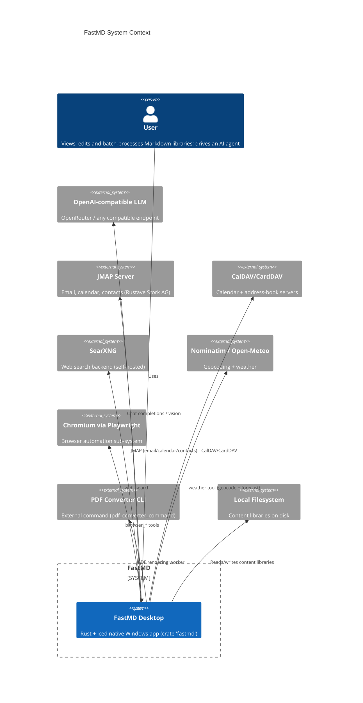
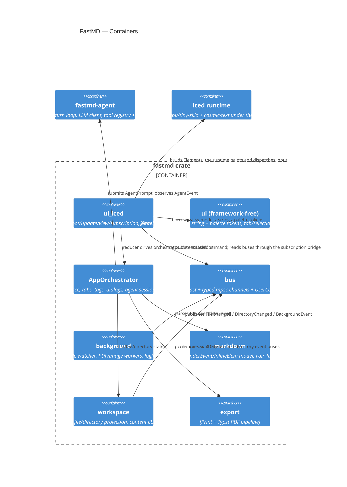
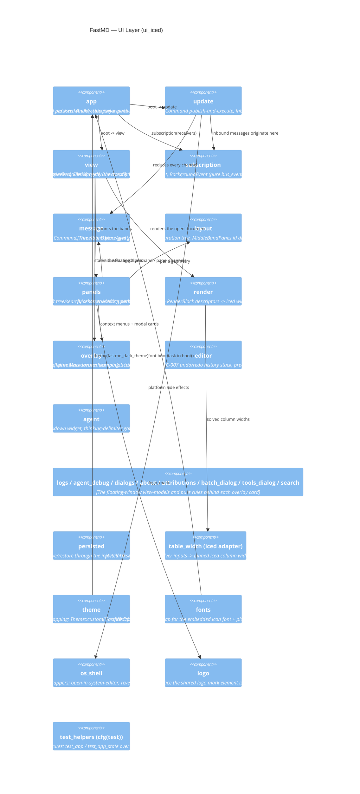
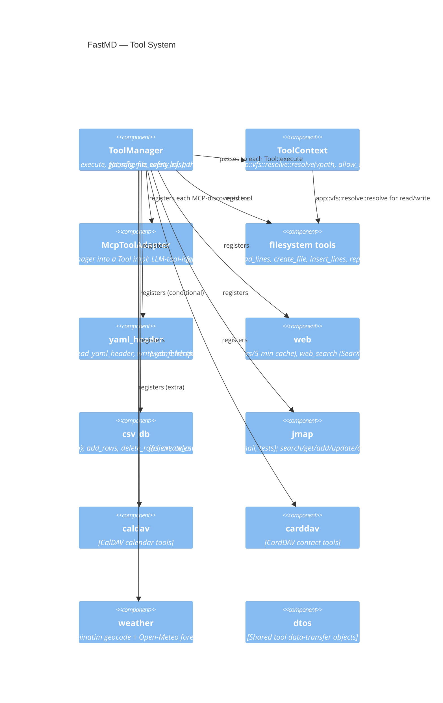
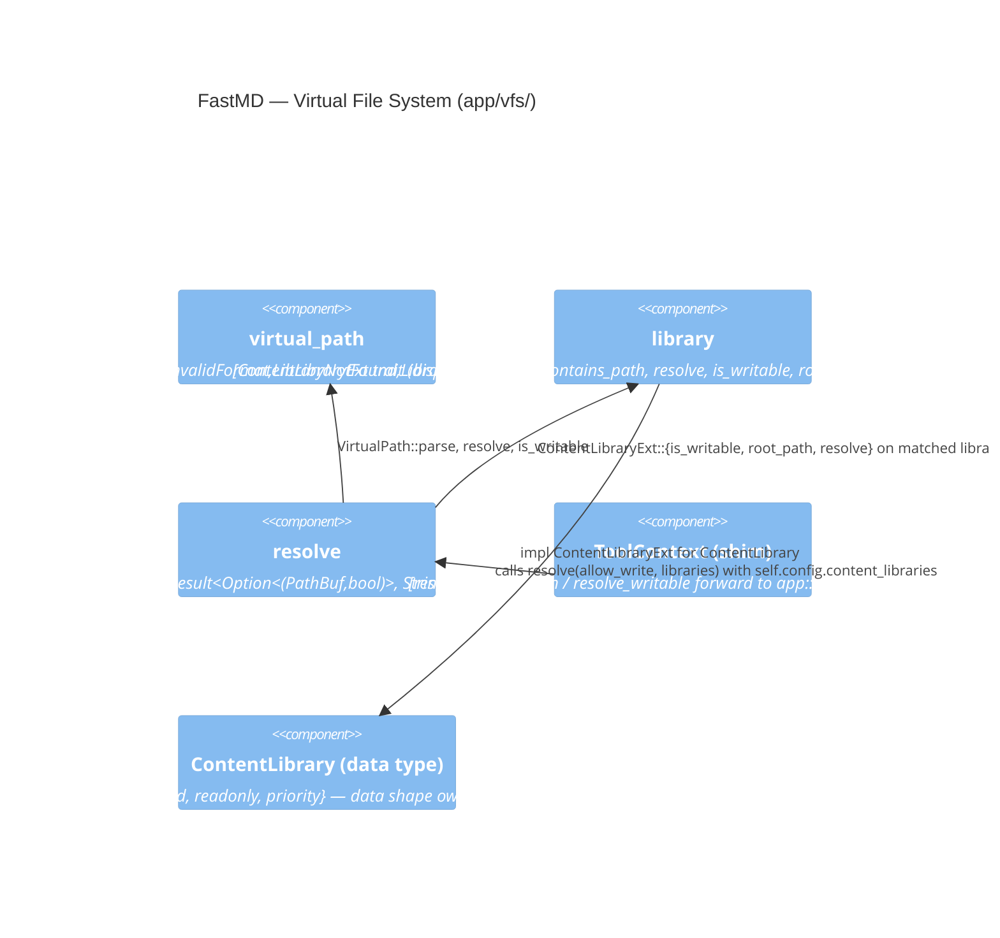
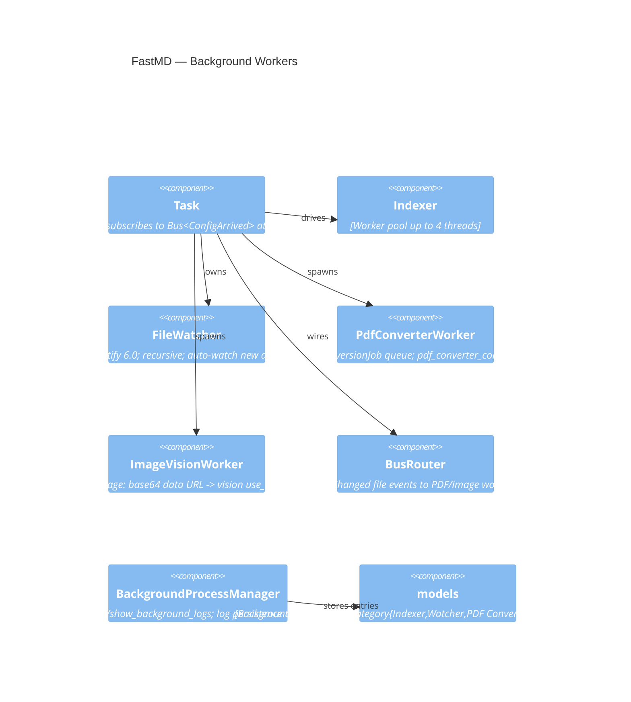
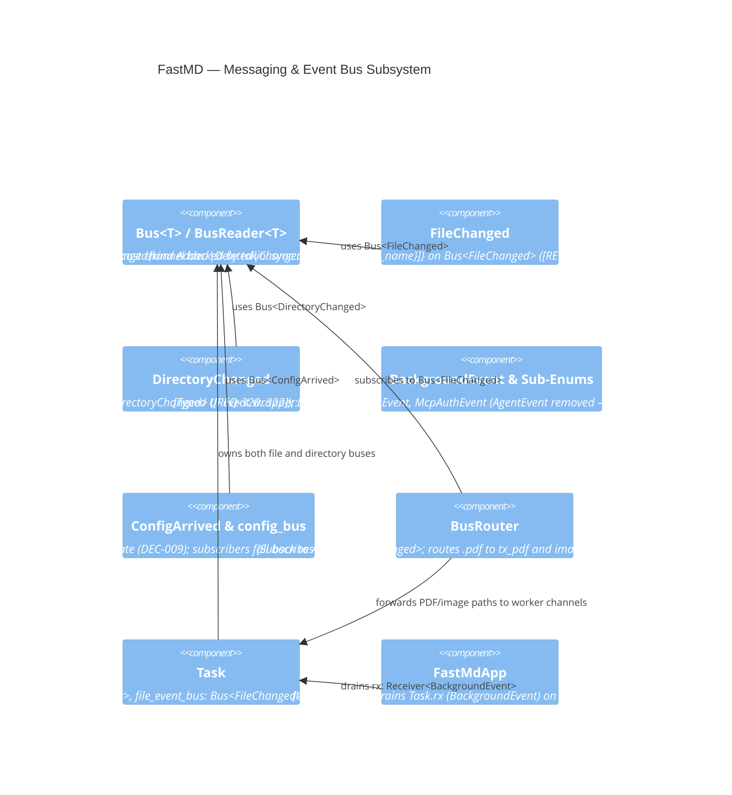
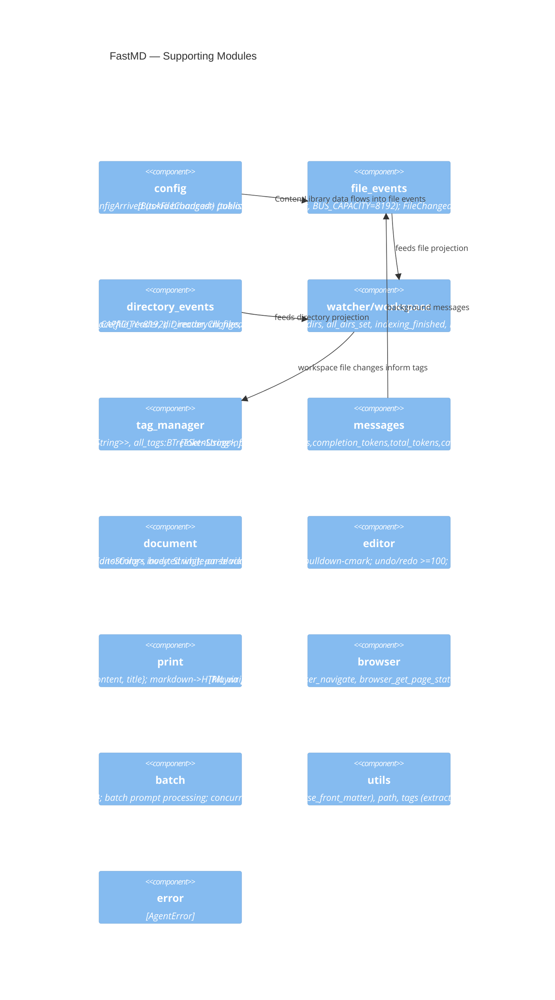

# FastMD C4 Architecture Diagram

## Context Diagram (Level 1)


## Container Diagram (Level 2)

The `fastmd` crate produces a single desktop application. The UI runs on the
**iced 0.14** runtime stack, all of it inside the one native binary:

| Layer | Crate (locked in `Cargo.lock`) | Role |
| --- | --- | --- |
| Windowing / OS event loop | `winit` 0.30 | Window creation, input events, DPI reports, close requests |
| GPU renderer | `wgpu` 27 | Hardware-accelerated paint (the `wgpu` cargo feature) |
| Software renderer | `tiny-skia` 0.11 | CPU paint path when no usable GPU backend is present |
| Text shaping | `cosmic-text` 0.15 | Font resolution, glyph shaping, text layout, hit-testing |
| Elm runtime + widgets | `iced` 0.14 / `iced_widget` 0.14.2 | `boot`/`update`/`view`/`subscription` loop, widget kit, theme/palette plumbing |

The application's own async work (buses, background workers, the agent driver)
runs on `tokio`; iced's futures executor is the default `thread-pool`, so the
two never share a runtime — they meet only at the `ui_iced::subscription`
bridge (see the Messaging diagram below).



## Optional Vector Search

When the `vector-search` feature is enabled, `app/background/vector_search.rs` owns a SahomeDB collection and `app/background/embeddings.rs` builds an OpenAI-compatible embedding client (via `async-openai`) from the user-configured `embeddings` model (AGENT-005). `Task` creates the shared service before starting the initial scan, subscribes it to `Bus<FileChanged>` before scan events are published, and injects the service into `AgentSession` through the existing `Extensions` container. Markdown chunks are hashed, embedded, and stored in the local collection; the read-only `vector_search` built-in tool performs searches through that service. The service does not replay file events emitted before its subscription and reports progress through `BackgroundEvent::Process(LogEntry(...))` every 100 processed Markdown files.


### UI Layer (Level 3)

`ui_iced/` renders the desktop app. The UI is one iced Elm loop — `boot`
(builds the state, returns the batched boot `Task` chain), `update` (the
reducer), `view` (pure widget construction) and `subscription` (the inbound
bus bridge) — wired together by `ui_iced::app::launch`. The loop's state is
`AppState` (`ui_iced/app.rs`), a **thin wrapper** around the framework-free
`FastMdApp` domain object plus the iced-specific runtime bits: the pane-grid
state, the live bus receivers, the injected UI-state storage, the OS scale
baseline and the last known viewport size.

The window is a **three-band** layout: the top toolbar band, the middle band,
and the bottom command band. The middle band is an
`iced::widget::pane_grid` split `left | (center | right)` — file tree,
document/agent surface, and the gated table-of-contents pane. Pane-grid resize
drags reduce 1:1 onto the pure `PanelLayout` widths, clamped by the UI-016
min/max constants. Every floating surface (context menu, inline editor, small
dialogs, log viewer, agent debug window, tools dialog, About, attributions,
batch dialog) is mounted by a single **overlay host** above the bands in a
fixed z-order, with a scrim layer that swallows input below the top card.

The view holds no state. Each panel is a pure function over a
view-model snapshot; all snapshots live in `AppState::models` and are rebuilt
by `AppState::rebuild_view_models` at the end of every `update` call, because
several iced widgets (notably `pick_list`) borrow their option vectors out of
the snapshot and cannot own them inside `view`. All colours flow from
`ui/theme.rs`, the single source of truth for the dark palette (`Palette`,
whose token type is `iced::Color`) and the inverted inline-editor token set
(`EditorColors`); `ui_iced/theme.rs` maps those semantic tokens onto the iced
palette roles and hands the resulting `iced::Theme::custom` to the launch
builder. Repeated iced idioms — the cursor-anchored, viewport-clamped context
menu, the blocking modal card, the confirm/cancel button pair, the
follow-the-stream scroll rule — live in `ui_iced/overlay.rs` and
`ui_iced/logs.rs`, which the panels, modals, tree and renderers call instead
of hand-rolling the widget tree.



Supporting UI types (framework-free, in `ui/`): `TreeNode{name,path,is_dir,children:BTreeMap}`,
`ToCEntry{title,level,id}`, `PersistedUiState{schema_version,left/right_panel_width,window_x/y/width/height,font_size_scale,expanded_dirs}`.

## Component Diagram (Level 3) — Agent Core

`agent/` implements the LLM tool-loop. A single long-lived driver thread
(spawned by `AgentSessionManager`) owns a `Receiver<AgentPrompt>` and blocks
on `recv()`. On each prompt, it builds a per-session `AgentContext` and runs
`run_agent` directly inline (no double-spawn). The agent publishes
`AgentEvent`s on a `Bus<AgentEvent>` (tokio broadcast); the UI subscribes
and drains per frame.

> **Agent↔UI Seam (feature 003, complete)**: `agent/events.rs` defines the
> structured seam types — `AgentPrompt` (UI→agent mpsc input, carries
> `session_id: Uuid` + `cancel_flag: Arc<AtomicBool>`), `AgentEvent`
> (agent→UI `Bus<AgentEvent>` broadcast output, 11 session-tagged variants),
> `AgentStatus` (typed status), `ToolSideEffect` (file-creation side effect),
> `DelegateToolCall` (structured web-delegate trace). The old
> `BackgroundEvent::Agent(LegacyAgentEvent)` variant and the
> `tx_gui: Sender<BackgroundEvent>` path have been removed. UI formatting
> lives in `ui/render/agent_render.rs`; the agent has zero `ui::render` imports.

```mermaid
C4Component
  title FastMD — Agent Core

  Component(mgr, "AgentSessionManager", "AgentState{running,status,thinking,response,history,token_usage,total_usage,debug_entries}; owns prompt_tx (UI→agent mpsc) + event_bus (agent→UI Bus); driver_handle: JoinHandle; current_session_id: Uuid"")
  Component(impl, "run_agent / run_agent_inner", "Resolves LLM client, builds messages, get_tools_schema, ToolExecutor::new, turn loop; called inline by the driver (no double-spawn)")
  Component(ctx, "AgentContext", "config, prompt, history, active_file, active_dir, selected_files, cancel_flag, session_id: Uuid, agent_event_bus, file_event_bus; no tx_gui, no current_response, no session_number")
  Component(ev, "events", "AgentPrompt (UI→agent mpsc, carries cancel_flag), AgentEvent (agent→UI Bus, 11 session-tagged variants), AgentStatus, ToolSideEffect, DelegateToolCall — the agent↔UI seam types")
  Component(llm, "LLMClient", "parse_usage_block; OpenAI-compatible HTTP")
  Component(pb, "SystemPromptBuilder", "with_active_file/dir/selected_files; USER.md injection per library")
  Component(te, "ToolExecutor", "returns (results, Vec<ToolSideEffect>); safe tools parallel / unsafe tools sequential")

  Rel(mgr, impl, "submit_prompt -> run_agent")
  Rel(impl, ctx, "builds per-session context")
  Rel(impl, ev, "publishes AgentEvent on Bus<AgentEvent>")
  Rel(mgr, ev, "owns event_bus: Bus<AgentEvent>")
  Rel(impl, llm, "chat completions")
  Rel(impl, pb, "system prompt")
  Rel(impl, te, "dispatch tools")
```

## Component Diagram (Level 3) — Tool System

`tools/` defines the `Tool` trait and a `ToolManager` (formerly
`ToolRegistry`) that owns the catalog of built-in and MCP-discovered
tools, the per-group enable/parallel-safe/error state, and the
[`McpClients`](../../src/agent/lib/mcp/mod.rs). `ToolContext<'a>` is the single
parameter passed to every `Tool::execute`, carrying `&AppConfig` and
`&Bus<FileChanged>`.





Tool inventory (matches `Tools.md` + conditional tools):
- **Core Workspace (11):** `grep`, `read_tags`, `list_files_by_tag`,
  `list_files`, `read_file`, `read_lines`, `create_file`,
  `insert_lines`, `replace_text`, `read_yaml_header`,
  `write_yaml_header`.
- **Web Integration (3):** `web_fetch`, `web_search`, `web_delegate`.
- **JMAP Productivity (11):** `search_calendar`, `get_calendar`,
  `get_calendar_item`, `add_calendar_item`, `update_calendar_item`,
  `delete_calendar_item`, `search_email`, `get_email_by_id`, `send_email`,
  `search_contact`, `get_contact`, `add_contact`.
- **Conditional / extra (6):** `add_rows`, `delete_rows`, `create_csv`,
  `list_csv`, `query` (CSV DB, prompt-keyword gated),
  `weather` (not in SPEC tool table).

> `tools/Spotify.md` is a **proposal** for 25+ `spotify_*` tools via OAuth2
> PKCE; not implemented.

## Component Diagram (Level 3) — Background Workers

`background/` hosts long-running workers, coordinated by `background_task::Task`
which owns the `mpsc` channels, `Bus<FileChanged>`, `Bus<DirectoryChanged>`,
and the `notify::RecommendedWatcher`.



## Component Diagram (Level 3) — Messaging Architecture (`bus/`)

The `bus/` subsystem provides explicit, type-safe event transportation across thread
boundaries in `fastmd`. All cross-thread updates (file modifications, background indexing
progress, agent turn streaming, worker log entries, MCP authentication) flow through either
multi-producer/multi-consumer broadcast buses (`Bus<T>`) or domain-specific typed `mpsc` channels.



### Overview & Design Principles

1. **Explicit Thread Communication**: Shared mutable state across thread boundaries is strictly avoided. Subsystems communicate exclusively via event channels.
2. **MPMC Broadcast vs MPSC Channels**:
   - **Multi-Producer Multi-Consumer (`Bus<T>`)**: Used when multiple consumers must independently observe the same event (for example, `FileChanged` is observed by the workspace projection, PDF-backing tracker, `BusRouter`, and vector search; `DirectoryChanged` is observed by the workspace projection).
   - **Multi-Producer Single-Consumer (`mpsc::channel`)**: Used when events target a single aggregator (e.g., UI frame loop draining `BackgroundEvent` or worker task queues).
3. **Non-Blocking UI Integration**: `BusReader` provides non-blocking `try_recv()` and `recv_timeout()` methods wrapped in a `Mutex`. In the iced build the UI never polls them directly: `ui_iced::subscription` turns every bus into an `iced::Subscription<Message>`, so background notifications arrive as messages on the Elm loop and the update/view path never blocks on I/O ([FMD-065]).

### Message Types & Payloads

- **`FileChanged`** (`bus/events/file.rs`, `Bus<FileChanged>`, [REQ-330..334]): one event-level `Kind` (`FileChangedKind::{Added, Deleted, Changed}`) describes the whole `[Files]` list ([REQ-331]); every entry (`FileEntry`) carries a fully qualified `path` ([REQ-333]) and its materialized `file_name` ([REQ-334]). A rename publishes `[Deleted]` then `[Added]` ([REQ-404]). `FileEventProducer` only publishes this file payload.
- **`DirectoryChanged`** (`bus/events/directory.rs`, `Bus<DirectoryChanged>`, [REQ-320..322]): one directory per event — fully qualified `path` ([REQ-321]) and `kind` (`DirectoryChangedKind::{Added, Deleted}`, [REQ-322]). A directory rename publishes `[Deleted]` then `[Added]` ([REQ-404]). `DirectoryEventProducer` only publishes this directory payload.
- **Producers:** `Indexer::scan_libraries` publishes file additions and directory additions as it enumerates entries ([REQ-320]/[REQ-330]); `FileWatcher` publishes file changes and directory lifecycle changes on their distinct buses ([REQ-402]); filesystem commands and agent tools publish file changes through the file producer.
- **`BackgroundEvent`** (`bus/events/typed.rs`): Top-level enum carrying domain-specific asynchronous updates to the UI loop:
  - **`FsEvent`**: `FileParsed { path, tags }`, `DirParsed { path }`, `FileModified { path, tags }`, `FileDeleted { path }`, `Finished`, `FinishedWithoutWatcher`. `DirParsed` has no current crawler producer; directory lifecycle is carried by `Bus<DirectoryChanged>`, while the legacy typed variant and handler remain for compatibility/tests.
  - **`ProcessEvent`**: `LogEntry(BackgroundLogEntry)`, `FileLoaded { path, content }`.
  - **`McpAuthEvent`**: `Completed { server_name, error }`.
- **`AgentEvent`** (`agent/events.rs`): Agent→UI `Bus<AgentEvent>` broadcast (tokio, capacity 8192). 11 session-tagged variants: `SessionStarted`, `SessionFinished{history}`, `Status(status: AgentStatus)`, `Thinking`, `ContentDelta`, `ToolCallStarted{id,name,args}`, `ToolResult{id,name,result}`, `ToolSideEffect`, `DebugEntry`, `TokenUsage`, `Failed`. Every variant carries `session_id: Uuid`.
- **`AgentPrompt`** (`agent/events.rs`): UI→agent mpsc input carrying `session_id`, `text`, `active_file/dir`, `selected_files`, `cancel_flag: Arc<AtomicBool>`. The long-lived driver thread blocks on `recv()`.
- **`ConfigArrived`** (`bus/events/config.rs`): Published once at startup carrying `config: AppConfig`. Enables lazy component initialization and prevents race conditions during startup. In the iced build the publish is synchronous inside `ui_iced::app::build_state` (after `BusReceivers::new`), so every subscriber is already live when the event is sent; a 10 s `CONFIG_ARRIVAL_TIMEOUT` fallback covers a delayed or missed publish.
- **`TokenUsageInfo`** (`bus/events/messages.rs`): Detailed LLM token consumption metrics (`prompt_tokens`, `completion_tokens`, `total_tokens`, `cached_tokens`, `reasoning_tokens`).

### Event Routing & Dispatch

1. **`BusRouter` (`bus/router/bus_router.rs`)**:
   - Subscribes to `Bus<FileChanged>` only; directory lifecycle events do not enter the conversion router.
   - Filters for `[FileChanged][Added]` and `[FileChanged][Changed]` events.
   - Inspects file extensions:
     - `.pdf` paths -> forwarded to `tx_pdf: Sender<PathBuf>` (`PdfConverterWorker`).
     - Image paths (`.jpg`, `.jpeg`, `.png`, `.gif`, `.webp`, `.bmp`, `.tiff`, `.avif`) -> forwarded to `tx_img: Sender<PathBuf>` (`ImageVisionWorker`).
2. **UI Inbound Bridge (`ui_iced/subscription.rs` + `ui_iced/update.rs`)**:
   - The bus→`Subscription` bridge owns one stream per bus (`Bus<ConfigArrived>`, `Bus<FileChanged>`, `Bus<DirectoryChanged>`, `Bus<AgentEvent>`) and one for the `std::sync::mpsc<BackgroundEvent>` channel, the last one behind a dedicated forwarding thread because iced's executor is the futures thread-pool, not tokio. Each stream maps its payload to `Message::Inbound(InboundMessage::…)` through the pure `bus_event_to_message` mapper. They are merged with `Subscription::batch` alongside the winit **window lane** (`iced::window::close_requests` / `resize_events`, mapped by the pure `close_request_to_message` / `resize_event_to_message` helpers onto `Message::Window`). With `exit_on_close_request: false` the close lane is the only path to the DEC-006 save-and-close reduction and the resize lane keeps `AppState::viewport` in step with real resizes.
   - A `Lagged(n)` error on any bus is not a disconnect: the stream logs the count and forwards `InboundMessage::EventsDropped { source, count }` so the reducer can surface the loss and re-synchronise on the next valid event ([FMD-067], [FMD-072]).
   - `reduce_inbound` in `ui_iced/update.rs` applies `FileChanged` and `DirectoryChanged` messages to the orchestrator's `Workspace` projection, then runs `process_file_events` to drain any legacy/catch-up readers; it also calls `drain_agent_event_bus` for `Agent`, `handle_fs_event` / `handle_process_event` / `handle_mcp_auth_event` for `Background`, and the config projection for `ConfigArrived`. The subscription bridge is the live inbound path in the iced build ([FMD-065]).
   - UI widget state lives in `AgentPanelState` (`ui/agent/panel_state.rs`) plus the reducer-held `OverlayState` / `ViewModels` (`ui_iced/app.rs`): `show_results`, `show_debug_window`, `debug_search_text`, `debug_auto_scroll`, `command_input`, `scroll_to_id`, `active_session_id`.

### Messaging Actors & Recipients Summary

| Channel / Bus | Transport Primitive | Payload Type | Producers (Actors) | Consumers (Recipients) |
|---|---|---|---|---|
| `Bus<FileChanged>` | `tokio::sync::broadcast` (8192 cap) via `Bus<T>` | `FileChanged` | `FileWatcher`, `Indexer`, filesystem commands, agent/tool file operations | `Workspace` / `AppOrchestrator`, PDF-backing tracker, `BusRouter`, vector search |
| `Bus<DirectoryChanged>` | `tokio::sync::broadcast` (8192 cap) via `Bus<T>` | `DirectoryChanged` | `FileWatcher`, `Indexer`, directory commands | `Workspace` / `AppOrchestrator` |
| `BackgroundEvent` | `std::sync::mpsc::channel` | `BackgroundEvent` (`Fs`, `Process`, `McpAuth`) | Agent Thread, Indexer Pool, `PdfConverterWorker`, `ImageVisionWorker`, MCP Auth Flow | `FastMdApp` (UI thread loop) |
| `Bus<ConfigArrived>` | `tokio::sync::broadcast` (8192 cap) via `Bus<T>` | `ConfigArrived` | `ui_iced::app::build_state` (synchronous, DEC-009) | background `Task` thread, MCP config subscriber, subscription bridge → UI reducer |
| `Bus<AgentEvent>` | `tokio::sync::broadcast` (8192 cap) via `Bus<T>` | `AgentEvent` (11 variants) | Agent driver thread (`run_agent`) | `FastMdApp` (UI frame drain → `AgentTranscript` + `AgentSessionManager`) |
| `AgentPrompt` | `std::sync::mpsc::channel` | `AgentPrompt { session_id, text, cancel_flag, ... }` | `AgentSessionManager::submit_prompt` (UI → agent) | Agent driver thread (`recv()` loop) |
| PDF Worker Queue | `std::sync::mpsc::channel` | `PathBuf` | `BusRouter` (for `.pdf` files) | `PdfConverterWorker` |
| Image Vision Queue | `std::sync::mpsc::channel` | `PathBuf` | `BusRouter` (for image files) | `ImageVisionWorker` |
| Agent Cancel | `std::sync::atomic::AtomicBool` | `bool` | `AgentSessionManager` (UI Stop button) | `run_agent_inner` turn loop |

## Component Diagram (Level 3) — Supporting Modules

Cross-cutting modules that the UI, Agent, Tools and Background all depend on.



## Test Surface

- **Integration tests** (`tests/`): the CommonMark spec conformance suite
  (`commonmark_spec_test.rs`) and the iced visual-test harness
  (`iced_visual_harness.rs`).
- **Inline `#[cfg(test)]` sidecar modules:** `agent/agent_impl_tests.rs`,
  `tools/jmap/tests.rs`, `bus/core.rs`, `bus/events/file.rs`, `bus/events/typed.rs`, `bus/config.rs`, `bus/router/bus_router.rs`.
- **UI tests — four tiers** (see `doc/distill/iced.md`):
  1. **Pure model** — the per-module `src/app/ui_iced/*_tests.rs` sidecars
     (39 files): view-model snapshots, message mappers, geometry solvers,
     reducers. No widget tree, no runtime.
  2. **Headless interaction** — `src/app/ui_iced/interaction_tests.rs`,
     driving the real `view` + real `update` through `iced_test::Simulator`
     and asserting the emitted `Message`s.
  3. **Screenshot baselines** — `tests/iced_visual/baselines/` (sha256 of
     the rendered frame), recorded and compared via the harness.
  4. **Recorded session replay** — `tests/iced_visual/ice/*.ice` replayed by
     `iced_test::run`.
  Tiers 3 and 4 are harness-complete but their artifacts await a human
  recording pass. Dev-deps also include `iced_test 0.14`, `proptest`,
  `filetime`, `tempfile`, `tokio` and `wiremock`.
